#  Enterprise RAG

A new project, separate from `../lightrag-ollama`. An internal knowledge portal built with React, FastAPI, LightRAG **1.5.7**, PostgreSQL/pgvector, and local Ollama (`qwen3.6:latest`, `qwen3-embedding:8b`, 4096 dimensions). Python and JavaScript dependencies are locked with `uv.lock` and `package-lock.json`.

The implementation covers OIDC login with PKCE, a BFF session, CSRF, roles, document ACL, tenant isolation, upload and versioning, an ingestion queue, retries, cited answers, audit, retention and deletion, an evaluation runner, and deployment and operations. **A working local configuration is not evidence that the system has passed company production acceptance.**

## Enterprise readiness

Production acceptance must cover the following areas. The included controls, tools, and deployment templates support these requirements; validate them with the company's infrastructure, documents, and operational owners before go-live.

| Area | Requirements | Project guidance and acceptance |
|---|---|---|
| Security | SSO, roles, document-level permissions, tenant isolation | OIDC/PKCE, application roles, document ACL, PostgreSQL RLS, and separate tenant RAG stores. Validate corporate SSO, permission revocation, and cross-tenant access denial. See [Architecture](docs/ARCHITECTURE.md). |
| Reliability | Backups, tested recovery, failover, ingestion retries | Backup and restore-drill scripts, HA templates, and durable ingestion jobs with leases, backoff, and dead-letter handling. Test recovery and failover on the actual deployment against agreed RPO/RTO targets. See [Operations](docs/OPERATIONS.md). |
| Operations | Monitoring, audit logs, alerts, upgrade procedures | Metrics, tracing, signed audit exports, and alert rules are included. Configure notification receivers and log retention; rehearse upgrades, migrations, and rollback. See [Operations](docs/OPERATIONS.md) and [Deployment](docs/DEPLOYMENT.md). |
| Performance | Load tests with your document volume and concurrent users | Run representative ingestion and query workloads, including the target document formats, sizes, and concurrent users. Measure throughput, p95/p99 latency, errors, and resource use. Capacity for 10,000 documents has not been validated. See [Quality and capacity](docs/QUALITY.md). |
| Answer quality | Evaluation using real questions, citation checks, acceptable error rates | Use reviewed company questions and a separate holdout set. Combine automated citation/security checks with human review of correctness, faithfulness, and completeness; agree acceptable error and abstention rates. See [Quality](docs/QUALITY.md). |
| Governance | Data retention, deletion, model-provider privacy, support ownership | Define retention and legal-hold policies, verify deletion and recovery reconciliation, and review local-model privacy and network egress. Assign knowledge, IAM, infrastructure, and on-call support owners. See [Governance](docs/GOVERNANCE.md). |

## Architecture



The API checks tenant membership and document permissions before retrieval and validates citations before returning an answer. The ingestion worker processes durable PostgreSQL jobs; LightRAG stores each tenant's graph and vectors in a separate database. Chat and embedding requests run through the private gateway to local Ollama.

This is a logical service overview. See [Architecture and security boundaries](docs/ARCHITECTURE.md) for the detailed request flows and production topology.

## Run locally

Prerequisites: Python 3.12, `uv`, Node.js 22+, Docker Compose, and Ollama. Run these commands from this project folder.

```sh
python3 scripts/configure.py
docker compose up -d --wait postgres
cd backend
uv sync --frozen
uv run alembic upgrade head
uv run rag-admin bootstrap
cd ../frontend
npm ci
npm run build
cd ..
ollama pull qwen3.6:latest
ollama pull qwen3-embedding:8b
backend/.venv/bin/python scripts/dev.py
```

Open **http://localhost:8088**. Use the hostname `localhost`, matching the redirect URI and the login cookie. The older project stays on port 9621.

Development login: open **Local development access** and use `alice`, `bob`, or `mallory`. The random password is in `.secrets/dev_password`. That file is not committed. Alice is the admin of tenant A, Bob is a viewer of tenant A, and Mallory is the admin of tenant B. A new document is **owner only**; share it with the **Permissions** button. Local real SSO can be enabled with:

```sh
docker compose --profile identity up -d keycloak
backend/.venv/bin/python scripts/sso_smoke.py
```

Then use **Sign in with SSO**. Development Keycloak is at http://localhost:8089. The imported realm is for the demo only, not for production.

Upload `examples/kebijakan-perjalanan.md`, wait until the status is **Ready**, then ask “What is the domestic travel hotel allowance?”. The expected result is Rp750,000 per night, with a citation. The sample source is written in Indonesian; the portal itself is in English. The document list, queue, permissions, audit trail, and evaluation results are available in the portal. PDFs must contain text. OCR for scans is not part of this pipeline.

## Where is data stored?

| Data | Development | Production |
|---|---|---|
| Users, membership, sessions, ACL, versions, jobs, audit, evaluation | Database `enterprise`, schema `app`, PostgreSQL Docker volume | PostgreSQL HA cluster |
| Keycloak | Database `keycloak`, its own role | Company IdP, or Keycloak HA operated by the IAM team |
| Chunks, vectors, entities, graph, LightRAG status | One logical database `rag_<tenant_uuid>` per tenant, in the same PostgreSQL | The same PostgreSQL HA cluster, with separate credentials |
| Immutable original files | `data/files/<tenant>/<document>/<version>.<ext>` | Encrypted shared NAS, with snapshots and backup |
| Workspace scratch and tokenizer | `data/runtime` | Local runtime disk; not a source of truth |
| HMAC-signed audit export | `data/audit-export/<tenant>/<event>.json` | A separate archive with an immutable/WORM policy, plus SIEM |
| Secrets | `.secrets/`, local `.env`, not committed | Company vault or secret manager; a file mount per service |

Everything uses one PostgreSQL platform. Logical database and role separation is an access boundary, not an extra database product. LightRAG is not given access to auth or application tables. Original files stay as files because download, checksum checks, and reindex need them. The vector database stores the searchable representation.

The 4096-dimension Qwen embedding uses **exact** cosine search in pgvector. This project does not force an HNSW `vector` index whose dimension limit does not match that configuration. Measure performance on the real corpus. Binary quantization or dimension reduction needs an adapter, an evaluation, and a tested reindex. `halfvec` HNSW is also limited to 4,000 dimensions, so it does not directly cover this 4,096-dimension embedding ([pgvector index limits](https://github.com/pgvector/pgvector#hnsw)).

## Application Docker

Configure, migrate, and provision locally first. Stop the native supervisor before reusing the same ports.

```sh
docker build -t cnf-enterprise-rag:dev .
# Development: use the local user UID/GID so bind mounts and secrets are readable.
RAG_UID=$(id -u) RAG_GID=$(id -g) docker compose -f compose.yaml -f compose.app.yaml up -d
# Production stays on UID 10001 with deployment-specific ownership; do not chmod 777.
```

Host Ollama must be reachable at `host.docker.internal:11434`. On Linux, restrict the firewall so that port is reachable only from the application network. An Ollama default that binds only 127.0.0.1 may need host network configuration. The native path above does not require changing the Ollama bind. `compose.app.yaml` is for development. The production manifest is rendered by Ansible with development login disabled.

Optional monitoring: add `-f compose.monitoring.yaml` and set `OTEL_EXPORTER_OTLP_ENDPOINT=http://otel:4318`. Prometheus is on localhost:9090 and Grafana on localhost:3000. The development Grafana password comes from `.secrets/metrics_token`. Production must use its own Grafana account or SSO and its own secret. The Alertmanager receiver is intentionally empty until the company notification destination is chosen.

## Testing and evaluation

```sh
cd backend
uv run ruff check rag_platform migrations tests
# Stop the worker while integration tests run so fixtures are not ingested.
uv run pytest -q
cd ../frontend
npm run build
cd ..
backend/.venv/bin/python scripts/smoke.py
```

The smoke test uses real LightRAG, PostgreSQL, and Ollama. Integration tests use real PostgreSQL with a model injected for the test. Local reports are in `reports/` (ignored by Git). For evaluation, replace the UUID in `eval/golden.template.jsonl` with your uploaded document ID, save it as `eval/golden.local.jsonl`, then:

```sh
cd backend
EVAL_DEV_PASSWORD_FILE=../.secrets/dev_password uv run rag-evaluate ../eval/golden.local.jsonl \
  --tenant aaaaaaaa-aaaa-4aaa-8aaa-aaaaaaaaaaaa --release local-v1 --record
```

Production and staging use `EVAL_TOKEN_FILE` with an IdP access token whose audience is `rag-portal`, a provisioned subject, and the tenant_admin role, so the result can be recorded. Do not store the token in the dataset or in CI logs. Build a dataset per identity and tenant for leakage tests, expected 404s, prompt injection, unanswered questions, and the citation allowlist. The regression runner measures deterministic checks. **Faithfulness and answer completeness still need a human review that uses company questions.** See [docs/QUALITY.md](docs/QUALITY.md).

## Deployment and operations

- [Architecture and security boundaries](docs/ARCHITECTURE.md)
- [Release, migration, and rollback](docs/DEPLOYMENT.md)
- [Backup, restore, failover, and incident response](docs/OPERATIONS.md)
- [Retention, privacy, and ownership](docs/GOVERNANCE.md)

Production needs a hostname, CA, SSO, host inventory, GPU, NAS, backup archive, ClamAV scanner, secret manager, and acceptance results. The example files contain placeholders that the release playbook rejects on purpose. Do not deploy the development `.env` or the demo realm to production.

Upstream references: [LightRAG](https://github.com/HKUDS/LightRAG), [Patroni installation](https://patroni.readthedocs.io/en/latest/installation.html), [pgBackRest user guide](https://pgbackrest.org/user-guide.html), [PostgreSQL Ubuntu packages](https://www.postgresql.org/download/linux/ubuntu/).
